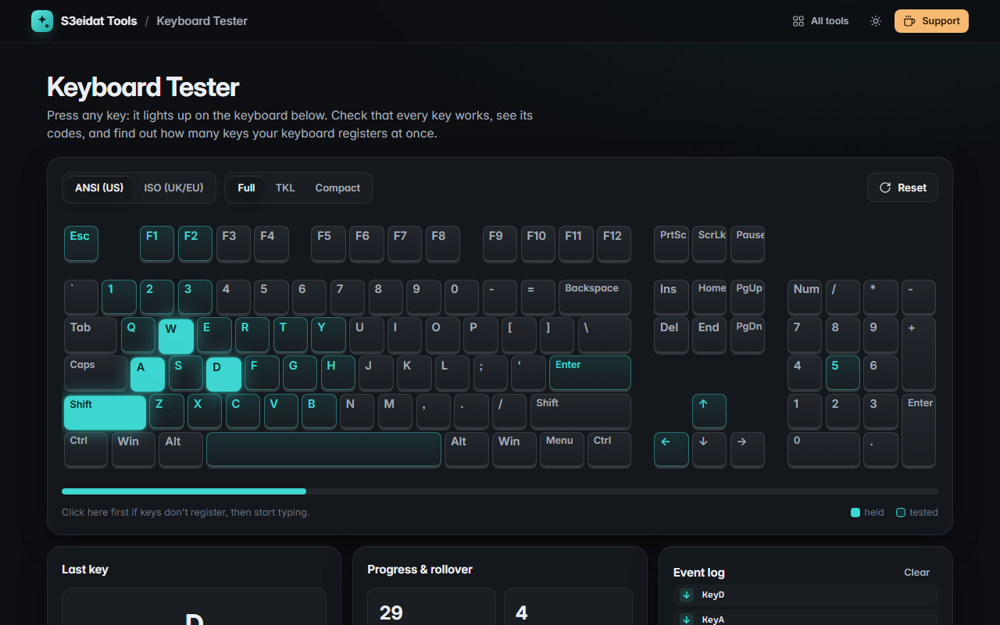

# Keyboard Tester

> Test every key on your keyboard. Free, private, and it runs entirely in your browser.

### ▶ [Open Keyboard Tester](https://s3eidat.github.io/keyboard-tester/)



## Features

- **Visual keyboard** that lights up as you press: held keys glow, tested keys stay tinted
- **ANSI (US, 104 keys)** or **ISO (UK/EU, 105 keys)** layout, with the L-shaped ISO Enter and the extra key next to left Shift
- **Full, TKL or compact** sizes (with or without the number pad and navigation keys)
- Keys are matched by **`event.code`** (the physical key), so it works whatever language your keyboard is set to
- **Key details**: `event.key`, `event.code`, `keyCode`, location (left / right / numpad) and active modifiers
- **Progress**: how many of the keys on the diagram you've tested, plus a progress bar
- **Rollover / ghosting test**: holds counted live, with the most keys registered at once
- Event log of the last presses and releases, and a list of keys you pressed that aren't on the diagram (media keys and so on)
- Captures keys so F5, Ctrl+P and friends don't fire while testing. Tab is captured once, then moves focus normally

Your operating system keeps some keys to itself (the Windows key, Alt+Tab, Ctrl+Alt+Del, the laptop Fn key), and
Print Screen only reports a key release on Windows; the tester counts that too.

## Privacy

Nothing you type is stored or sent. Only your layout and size choice are kept in this browser's local storage.
There is no server, no account, no analytics. The page ships with a strict Content-Security-Policy
(`connect-src 'self'`), so the browser itself blocks any attempt to send data anywhere.

## Run it yourself

It's plain HTML, CSS and JavaScript with no build step:

```bash
git clone https://github.com/s3eidat/keyboard-tester
cd keyboard-tester
python -m http.server 8000
```

Then open http://localhost:8000.

## Support

If this saved you time, **[buy me a coffee ☕](https://s3eidat.github.io/coffee/)**. It keeps every tool free.

---

Part of **[S3eidat Tools](https://s3eidat.github.io/)**: 100+ free, private tools that run in your browser. MIT licensed.
